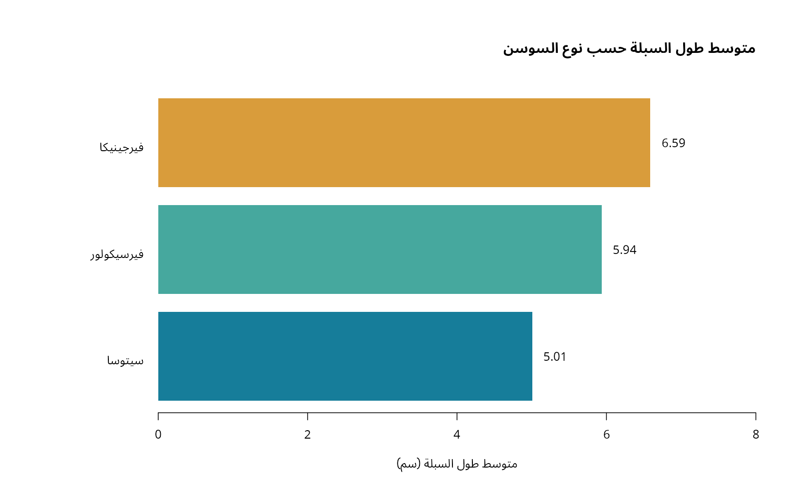
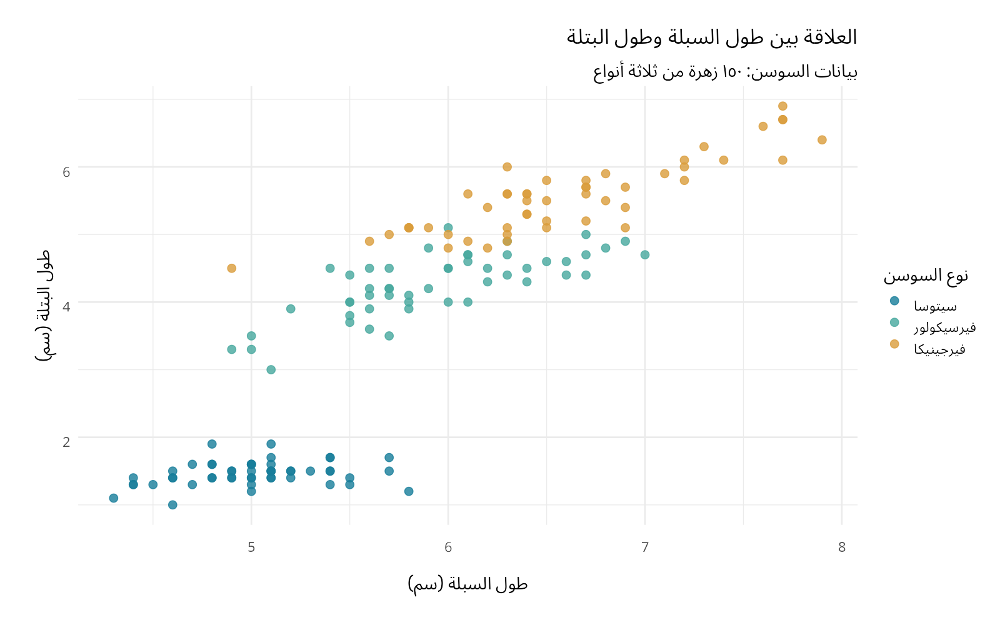
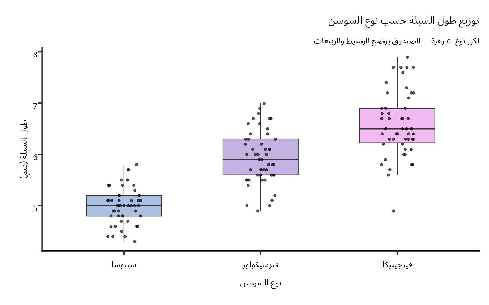
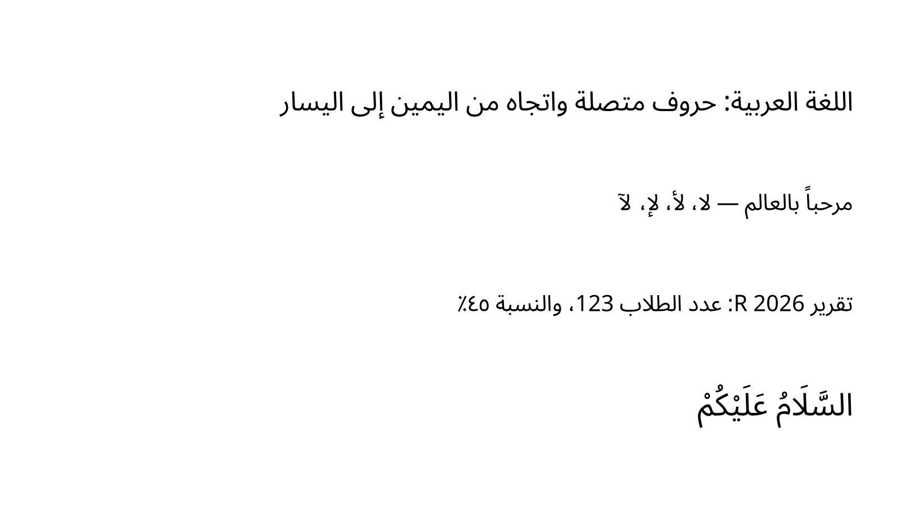

# arabicR

**Alpha 1** — GitHub tag `v0.1.0-alpha.1`, R package version `0.1.0.9000`. The API may change during alpha development.

Arabic text, connected letters, and right-aligned graphics for R, using **Noto Sans Arabic**, **ragg**, **textshaping**, and **Cairo**.

## Install

Install Noto Sans Arabic on your system first. On Debian/Ubuntu:

```sh
sudo apt-get install fonts-noto-core
```

In R:

```r
install.packages(c("systemfonts", "ragg", "textshaping", "ggplot2", "ggprism"))
install.packages("remotes")
remotes::install_github("mac860/1@v0.1.0-alpha.1")
```

For a local checkout, install the dependencies above and run `R CMD INSTALL .`. Source builds of the graphics dependencies may require development libraries for Fontconfig, FreeType, HarfBuzz, FriBidi, PNG, TIFF, and JPEG; Cairo must be enabled in R for the Cairo devices. Restart R after installing fonts. Font files are not bundled or downloaded by this package.

## Windows: dependency updates and download troubleshooting

If `library(ragg)` reports that `systemfonts` 1.2.3 is already loaded but a newer version is required, restart R **before** updating packages. In RStudio use **Session → Restart R** (`Ctrl+Shift+F10`). Do not load arabicR or other plotting packages yet:

```r
install.packages(
  c("systemfonts", "textshaping", "ragg", "ggplot2", "ggprism"),
  repos = "https://cran.rstudio.com",
  type = "binary"
)
```

Restart R again after installation, then verify:

```r
library(ragg)
library(arabicR)
packageVersion("systemfonts") # >= 1.3.1
packageVersion("textshaping") # >= 1.0.5
packageVersion("ragg")        # >= 1.4.0
arabic_font()                # Noto Sans Arabic must be installed
```

The message `Install the 'ragg' package` can also mean ragg is installed but cannot load a dependency. Run `library(ragg)` to see the underlying error. Updating files on disk does not replace an older namespace already loaded in the current R session.

Rtools is not needed for Windows binary dependency installs or this pure R package. Building graphics dependencies from source does require the appropriate build tools. A `built under R version 4.5.3` warning is separate from the loaded-systemfonts error; using the current R 4.5.x patch release is recommended.

If `install_github()` cannot download from `api.github.com`, try the release archive:

```r
remotes::install_url(
  "https://github.com/mac860/1/releases/download/v0.1.0-alpha.1/arabicR_0.1.0.9000.tar.gz",
  dependencies = TRUE,
  upgrade = "never"
)
```

If browser downloads work but R downloads fail, download the `.tar.gz` from the [release page](https://github.com/mac860/1/releases/tag/v0.1.0-alpha.1), install the dependencies above, then select the archive:

```r
install.packages(file.choose(), repos = NULL, type = "source")
```

`* DONE (arabicR)` means installation succeeded. For download failures, run `warnings()` immediately afterward and inspect the certificate, timeout, HTTP, or proxy message. Enabling a regular release does not change GitHub's API download route.

## Draw Arabic

```r
library(arabicR)
arabic_font() # Fails clearly if Noto Sans Arabic is missing
render_arabic <- function(filename = "arabic.png") {
  arabic_png(filename) # ragg is the default
  on.exit(grDevices::dev.off(), add = TRUE)
  grid::grid.newpage()
  arabic_text("مرحباً بالعالم", y = 0.7, size = 32)
  arabic_text("تقرير R 2026: عدد الطلاب 123", y = 0.4)
}
render_arabic()
```

The function registers device cleanup only after opening succeeds. Calling `dev.off()` after a failed device open causes `cannot shut down device 1 (the null device)`.

Text is supplied in ordinary **logical Unicode order**. Do not reverse characters: that can break connected letters, punctuation, and mixed Arabic/English text. Use ragg 1.4.0, systemfonts 1.3.1, and textshaping 1.0.5 or newer; older versions can corrupt fallback glyphs in mixed Arabic/Latin text. ragg uses HarfBuzz shaping and FriBidi bidirectional layout through textshaping. Right alignment controls the text's anchor; the renderer controls letter connections and bidirectional ordering.

```r
# Alternative Cairo devices (requires capabilities("cairo"))
arabic_png("arabic-cairo.png", backend = "cairo")
arabic_text("السَّلَامُ عَلَيْكُمْ")
dev.off()

arabic_pdf("arabic.pdf")
arabic_text("اللغة العربية — لا، لأ، لإ، لآ")
dev.off()

# Inspect shaped glyphs, not a reversed or pre-shaped string
arabic_shape("السلام عليكم")
```

For base graphics on these devices, use `text(..., family = arabic_font(), adj = 1)` for a right anchor. For grid use `arabic_text()` or `arabic_grob()`. For ggplot2 add `arabic_theme()` and save using a ragg device; the complete example is in [inst/examples/arabic.R](inst/examples/arabic.R).

## Iris plot showcase: native R, ggplot2, and ggprism

These examples use the built-in `datasets::iris` data: 150 flowers, 50 per species. Measurements are in centimetres. Arabic species names are transliterations of the original species labels. No external database, download, or credentials are required.

Run all three plots with `Rscript inst/examples/iris.R`, or from an installed copy containing the new examples:

```r
source(system.file("examples", "iris.R", package = "arabicR"))
```

The existing Alpha 1 archive predates this showcase. Use the repository script for these new examples, or install the latest repository with `remotes::install_github("mac860/1")`.

For interactive use, run this shared setup first, then any of the examples below:

```r
library(arabicR)
library(ggplot2)
font <- arabic_font()
iris_ar <- datasets::iris
iris_ar$species_ar <- factor(
  iris_ar$Species,
  levels = c("setosa", "versicolor", "virginica"),
  labels = c("سيتوسا", "فيرسيكولور", "فيرجينيكا")
)
iris_output <- Sys.getenv("ARABICR_OUTPUT_DIR", "arabic-output")
dir.create(iris_output, recursive = TRUE, showWarnings = FALSE)
save_iris <- function(filename, draw) {
  arabic_png(file.path(iris_output, filename), width = 1600, height = 1000)
  on.exit(grDevices::dev.off(), add = TRUE)
  draw()
}
```

### Native R barplot: mean sepal length

Arabic category labels, a right-aligned title, and numeric mean labels use the selected Arabic font through a ragg device. The bar lengths start at zero.

```r
save_iris("iris-barplot.png", function() {
  means <- tapply(iris_ar$Sepal.Length, iris_ar$species_ar, mean)
  graphics::par(family = font, mar = c(6, 11, 6, 3), las = 1)
  bars <- graphics::barplot(
    means, horiz = TRUE, col = c("#167d9a", "#46a89e", "#d99c3b"),
    border = NA, xlim = c(0, 8), xlab = "متوسط طول السبلة (سم)"
  )
  graphics::title(main = "متوسط طول السبلة حسب نوع السوسن", adj = 1)
  graphics::text(as.numeric(means) + 0.15, bars,
                 labels = formatC(means, digits = 2, format = "f"), adj = 0)
})
```



### ggplot2: sepal length versus petal length

All 150 observations are plotted, with Arabic axis labels, a species legend, and `arabic_theme()`.

```r
save_iris("iris-ggplot.png", function() {
  p <- ggplot(iris_ar, aes(Sepal.Length, Petal.Length, colour = species_ar)) +
    geom_point(size = 2.8, alpha = 0.8) +
    scale_colour_manual(values = c("#167d9a", "#46a89e", "#d99c3b")) +
    labs(title = "العلاقة بين طول السبلة وطول البتلة",
         subtitle = "بيانات السوسن: ١٥٠ زهرة من ثلاثة أنواع",
         x = "طول السبلة (سم)", y = "طول البتلة (سم)", colour = "نوع السوسن") +
    arabic_theme(base_size = 14)
  print(p)
})
```



### ggprism: distributions by species

Use `theme_prism(base_family = font)` to preserve the Prism appearance and Arabic font. Apply text alignment afterward; adding the complete `arabic_theme()` would replace the Prism theme. Boxes summarize the distributions and seeded jitter shows individual flowers reproducibly.

```r
save_iris("iris-ggprism.png", function() {
  p <- ggplot(iris_ar, aes(species_ar, Sepal.Length, fill = species_ar)) +
    geom_boxplot(width = 0.55, outlier.shape = NA, alpha = 0.65) +
    geom_point(position = position_jitter(width = 0.12, height = 0, seed = 860),
               size = 1.7, alpha = 0.65) +
    ggprism::scale_fill_prism(palette = "floral") +
    labs(title = "توزيع طول السبلة حسب نوع السوسن",
         subtitle = "لكل نوع ٥٠ زهرة — الصندوق يوضح الوسيط والربيعات",
         x = "نوع السوسن", y = "طول السبلة (سم)") +
    ggprism::theme_prism(base_family = font, base_fontface = "plain", base_size = 14) +
    theme(text = element_text(lineheight = 1.2),
           legend.position = "none",
           plot.title = element_text(hjust = 1),
           plot.subtitle = element_text(hjust = 1, vjust = 0.5, size = 13),
           plot.margin = margin(16, 16, 24, 16),
           axis.title.x = element_text(vjust = 0.5, margin = margin(t = 10, b = 8)),
           axis.title.y = element_text(vjust = 0.5, margin = margin(r = 10, l = 8)))
  print(p)
})
```



Text direction and category order are separate. Change factor levels explicitly when you want a different species order; do not reverse Arabic characters.

## Examples and validation

From the repository root after installing the package:

```sh
Rscript inst/examples/arabic.R
Rscript inst/examples/iris.R
Rscript tests/rendering.R
R CMD build .
R CMD check --no-manual arabicR_0.1.0.9000.tar.gz
```

With an installed package, you can also run `source(system.file("examples", "arabic.R", package = "arabicR"))`.

The text example produces ragg and Cairo PNGs, a Cairo PDF, and an optional ggplot2 chart. The iris showcase adds native barplot, ggplot2 scatter, and ggprism boxplot PNGs. All outputs are saved in `arabic-output/`. Set `ARABICR_OUTPUT_DIR` to choose another directory. Inspect the images for joining, lam-alef ligatures, diacritics, and mixed Arabic/Latin numbers. Automated tests check glyph shaping and device output; image creation alone cannot prove visual typography is correct.

Cairo's text handling depends on your R build and platform. Prefer ragg for consistent PNG output. The package does not change console direction, editor layout, axis order, or table column order. `arabic_theme()` right-aligns plot titles, subtitles, and captions; choose factor levels or axis direction separately when your chart requires them.

## Rendered example



A [PDF example](inst/examples/output/arabic-cairo.pdf) is also included.

In this prepared cloud workspace, activate the local R runtime before running commands:

```sh
. /workspace/.arabic-r/activate
cd /workspace/1
R CMD INSTALL .
Rscript inst/examples/arabic.R
```

On other machines use your normal R installation; the workspace activation step is specific to this cloud environment.

[شرح الأمثلة بالعربية](inst/examples/README-ar.md)
